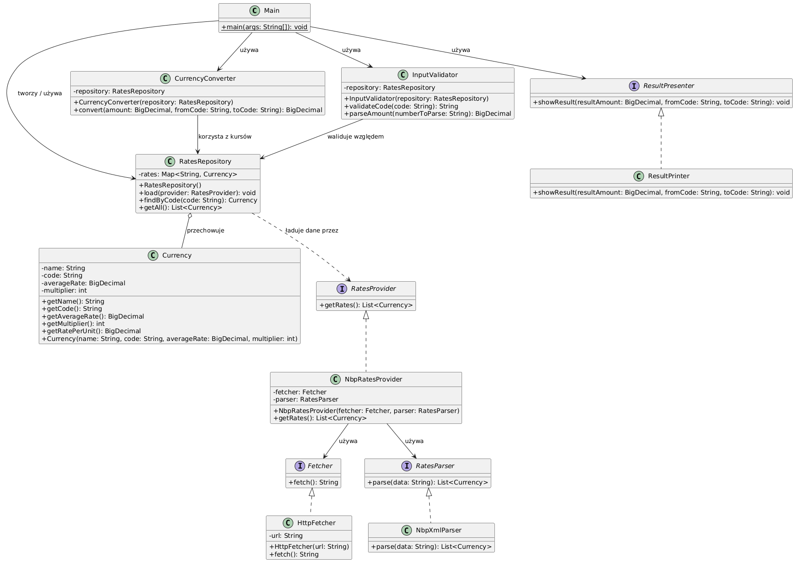

# Currency Converter

Konsolowy kalkulator walut napisany w Javie w ramach przedmiotu *Technologie Obiektowe* (Laboratorium 1).
Program pobiera aktualne średnie kursy walut (tabela A) publikowane przez Narodowy Bank Polski (NBP)
i przelicza kwoty między dowolnymi dwiema walutami z tabeli, w tym PLN.

## Funkcjonalności

- Pobieranie aktualnych kursów z NBP: `https://static.nbp.pl/dane/kursy/xml/LastA.xml`
- Przeliczanie między dowolnymi dwiema walutami z tabeli; PLN jest zawsze dostępny
- Obsługa przeliczników NBP (np. kurs JPY podawany za 100 jednostek)
- Walidacja danych wejściowych: kody walut bez względu na wielkość liter, kwoty z kropką lub przecinkiem
- Obliczenia na `BigDecimal`, wynik zaokrąglany do 2 miejsc po przecinku (`HALF_UP`)
- Interaktywna pętla: wpisanie `exit` w dowolnym momencie kończy program

## Wymagania

- JDK 25 (`Main.java` korzysta z metody instancyjnej `void main()`)
- Połączenie z internetem (do pobrania kursów)
- IntelliJ IDEA (pliki projektu są w repozytorium) lub dowolne IDE / `javac`

## Uruchomienie

**IntelliJ IDEA:** otwórz folder `Lab1` i uruchom `Main`.

**Z linii poleceń:**

```bash
javac -d out src/*.java
java -cp out Main
```

Przykładowa sesja:

```
Currency converter (NBP). Type 'exit' to quit.
From currency (or exit): usd
Amount: 100
To currency: eur
Converted amount: ... EUR

From currency (or exit): exit
Bye.
```

## Architektura

Projekt rozdziela pobieranie, parsowanie, przechowywanie, przeliczanie i prezentację danych.
Klasy zależą od interfejsów, a nie od konkretnych implementacji, dzięki czemu każdą część
można podmienić lub przetestować osobno.



| Typ | Rodzaj | Odpowiedzialność |
|---|---|---|
| `Currency` | klasa | Model waluty (nazwa, kod, kurs średni, przelicznik); `getRatePerUnit()` zwraca kurs za 1 jednostkę |
| `Fetcher` | interfejs | Pobiera surowe dane z kursami w postaci tekstu |
| `HttpFetcher` | klasa | Implementacja `Fetcher` pobierająca dane przez HTTP |
| `RatesParser` | interfejs | Zamienia surowe dane na listę obiektów `Currency` |
| `NbpXmlParser` | klasa | Implementacja `RatesParser` dla formatu XML NBP |
| `RatesProvider` | interfejs | Dostarcza listę walut |
| `NbpRatesProvider` | klasa | Łączy `Fetcher` i `RatesParser`, dostarczając kursy NBP |
| `RatesRepository` | klasa | Przechowuje waluty według kodu, dodaje PLN, jeśli go brakuje |
| `CurrencyConverter` | klasa | Przelicza kwotę między dwiema walutami na podstawie repozytorium |
| `InputValidator` | klasa | Waliduje kody walut i parsuje kwoty wpisane przez użytkownika |
| `ResultPresenter` | interfejs | Prezentuje wynik przeliczenia |
| `ResultPrinter` | klasa | Implementacja `ResultPresenter` wypisująca wynik na konsolę |
| `Main` | punkt wejścia | Składa komponenty i uruchamia interaktywną pętlę |

Wzór przeliczenia:

```
wynik = kwota × kurs(z) / kurs(na)      gdzie kurs = kurs średni / przelicznik
```

## Testy

Testy jednostkowe (JUnit 5) znajdują się w folderze `test/` i obejmują wszystkie klasy poza `Main`.
Nie wymagają internetu: kursy pochodzą z danych testowych, a `HttpFetcher` jest testowany
na lokalnym serwerze HTTP.

W IntelliJ IDEA: kliknij prawym przyciskiem folder `test` i wybierz **Run 'All Tests'**.
Biblioteka JUnit jest skonfigurowana w `.idea/libraries` i pobierana automatycznie z Mavena.

## Struktura projektu

```
Lab1/
├── src/        kod źródłowy aplikacji
├── test/       testy jednostkowe JUnit 5
├── UML.png     diagram klas
└── Lab1.iml    moduł IntelliJ IDEA
```
